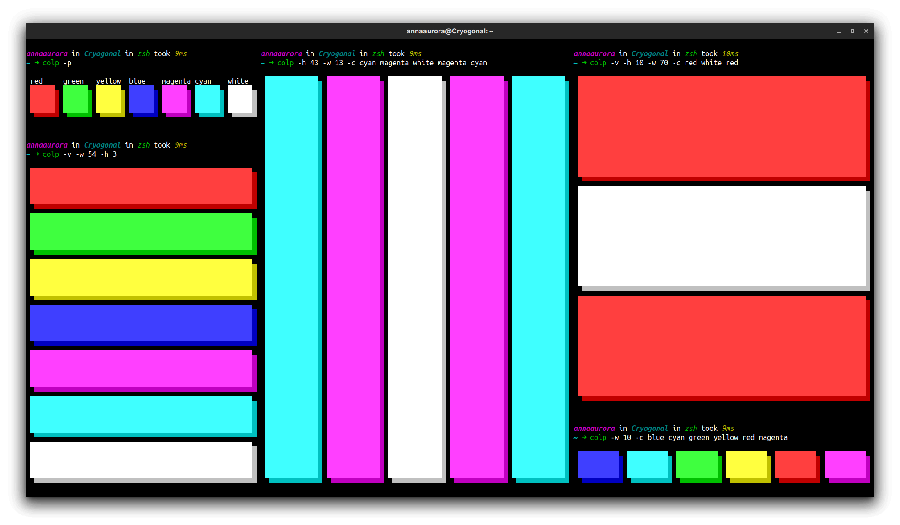

# colorpanes 🌈

Panes in the 8 bright terminal colors with shadows of the respective darker color.

## Reason for making

colorpanes was made to replace the [panes.sh](https://github.com/PanicKk/dotfiles/blob/2e53d25f95cb397993358fcd47ba3c69da0da706/custom-scripts/panes.sh) shell script.

### Benefits of colorpanes opposed to panes.sh:

- Foreground and background color to have a shadow
- Ability to control height and width of colorpanes
- Select between horizontal and vertical colorpanes
- Ability to remove margin
- Ability to add captions
- Made in Rust: memory-safe, fast, code that you can actually understand unlike the panes.sh

## Installation

### Prerequisites

colorpanes should work on any system with a shell that supports running binaries.

### Packages

| Operating System                                     | Package Manager  | Package                         | Command                                                                               |
| ---------------------------------------------------- | ---------------- | ------------------------------- | ------------------------------------------------------------------------------------- |
| [Various][rust-platforms]                            | [Cargo][cargo]   | [colorpanes][colorpanes-crate]  | `cargo install colorpanes`                                                            |
| [Arch Linux][arch linux]                             | [pacman][pacman] | [colorpanes][colorpanes-pacman] | `git clone https://aur.archlinux.org/colorpanes.git && cd colorpanes && makepkg -sri` |
| [NixOS][nixos], [Linux][nix-plat], [macOS][nix-plat] | [Nix][nix]       | [colorpanes][colorpanes-nixpkg] | `nix-env -iA nixos.colorpanes` or `nix-env -iA nixpkgs.colorpanes`                    |

[rust-platforms]: https://forge.rust-lang.org/release/platform-support.html
[cargo]: https://www.rust-lang.org
[colorpanes-crate]: https://crates.io/crates/colorpanes
[arch linux]: https://www.archlinux.org
[pacman]: https://wiki.archlinux.org/title/Pacman
[colorpanes-pacman]: https://aur.archlinux.org/packages/colorpanes
[nixos]: https://nixos.org/nixos/
[nix-plat]: https://nixos.org/nix/manual/#ch-supported-platforms
[nix]: https://nixos.org/nix/
[colorpanes-nixpkg]: https://github.com/NixOS/nixpkgs/blob/master/pkgs/tools/misc/colorpanes/default.nix

## Running

See [the installation section](#installation) for how to install colorpanes on your computer.

Note: `colorpanes` does not work if you installed it via cargo:
- Run colorpanes with `colp` or `colorpanes`.
- Use `colp --help` or `colorpanes --help` to look up how to pass options to colorpanes.

## License

### Code

©️ 2022 Anna Aurora Neugebauer <mailto:papojari-git.ovoid@aleeas.com> <https://matrix.to/#/@papojari:artemislena.eu> <https://papojari.codeberg.page>

This program is free software: you can redistribute it and/or modify it under the terms of the GNU Lesser General Public License version 3 as published by the Free Software Foundation.

This program is distributed in the hope that it will be useful, but WITHOUT ANY WARRANTY; without even the implied warranty of MERCHANTABILITY or FITNESS FOR A PARTICULAR PURPOSE. See the GNU General Public License for more details.

You should have received a copy of the GNU Lesser General Public License version 3 along with this program. If not, see <https://www.gnu.org/licenses/>.

### [Screenshot](screenshot.png)

©️ 2022 Anna Aurora Neugebauer. This work is licensed under the CC BY-SA 4.0 license.
